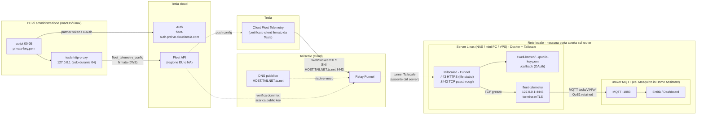
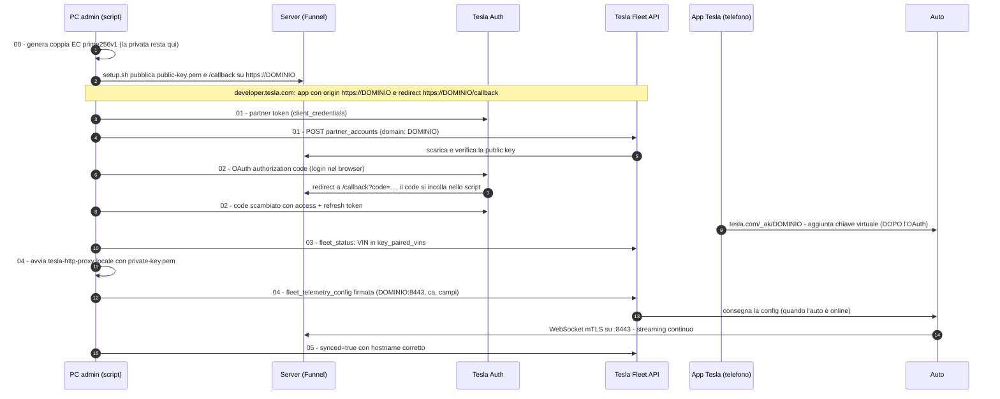

# Tesla Fleet Telemetry → MQTT / Home Assistant (self-hosted)

Ricevi in tempo reale i dati della tua Tesla in **MQTT** (e quindi in Home Assistant) usando il protocollo
ufficiale **Tesla Fleet Telemetry**, con un server **self-hosted** su qualsiasi host Linux (NAS, mini PC,
home server, VPS) esposto su Internet tramite **Tailscale Funnel**:

- nessuna porta aperta sul router, nessun IP pubblico o DDNS necessario;
- nessun servizio a pagamento (il consumo Fleet API rientra nello sconto mensile Tesla per uso personale);
- l'auto non viene mai svegliata per leggere i dati: è lei che invia i campi quando cambiano.

---

## Indice

1. [Come funziona](#come-funziona)
2. [Architettura](#architettura)
3. [Catena di fiducia e setup una tantum](#catena-di-fiducia-e-setup-una-tantum)
4. [Componenti](#componenti)
5. [Struttura del repository](#struttura-del-repository)
6. [Prerequisiti](#prerequisiti)
7. [Configurazione (`config.env`)](#configurazione-configenv)
8. [Installazione passo passo](#installazione-passo-passo)
9. [Verifica](#verifica)
10. [Modificare i campi in streaming](#modificare-i-campi-in-streaming)
11. [Formato dei dati MQTT](#formato-dei-dati-mqtt)
12. [Adattare ad altri server](#adattare-ad-altri-server)
13. [Manutenzione e scadenze](#manutenzione-e-scadenze)
14. [Troubleshooting](#troubleshooting)
15. [Sicurezza](#sicurezza)
16. [Costi](#costi)
17. [Alternative scartate](#alternative-scartate)
18. [Riferimenti](#riferimenti)

---

## Come funziona

Con Fleet Telemetry **non si interroga l'auto**: è l'auto che apre una connessione WebSocket **mTLS** verso
un server indicato da te e vi spinge i campi configurati, ciascuno solo quando cambia e non più spesso
dell'intervallo minimo impostato. Se perde la connessione bufferizza fino a 5.000 messaggi e li consegna
alla riconnessione.

Perché l'auto accetti di inviare dati al tuo server servono:

1. un'**app** su developer.tesla.com con un **dominio** che pubblica la **chiave pubblica EC** dell'app;
2. il **consenso OAuth** dell'account proprietario dell'auto;
3. la **chiave virtuale** (la stessa chiave pubblica) installata sull'auto tramite l'app Tesla;
4. una **configurazione di telemetria firmata** con la chiave privata (via `tesla-http-proxy`) che indica
   hostname, porta, CA del server e campi. **L'hostname deve appartenere al dominio dell'app.**

Il server (`fleet-telemetry`, immagine ufficiale Tesla) gira in Docker, termina l'mTLS dell'auto e pubblica
ogni campo su MQTT. Tailscale Funnel fornisce il nome pubblico (`<host>.<tailnet>.ts.net`), il certificato
Let's Encrypt e l'ingresso da Internet senza toccare il router: lo stesso nome fa da **dominio dell'app
Tesla** e da **hostname di telemetria**, soddisfacendo il vincolo del punto 4.

---

## Architettura



- **Nessuna connessione in ingresso verso la tua rete**: `tailscaled` mantiene una connessione *uscente*
  verso Tailscale; i relay Funnel instradano il traffico pubblico dentro quel tunnel.
- Sulla **porta 8443** Funnel fa **TCP passthrough**: non decifra nulla, il TLS (con il certificato client
  dell'auto) arriva intatto a `fleet-telemetry`, l'unico a terminarlo. È indispensabile: Tesla identifica il
  veicolo dal certificato client mTLS.
- Sulla **porta 443** Funnel fa HTTPS (terminato da `tailscaled`) e serve solo file statici: la chiave
  pubblica richiesta da Tesla e la pagina `/callback` per l'OAuth.
- `fleet-telemetry` ascolta **solo su 127.0.0.1**: non è raggiungibile dalla LAN, da Internet solo via Funnel.

---

## Catena di fiducia e setup una tantum



---

## Componenti

| Componente | Dove | Ruolo |
|---|---|---|
| App Tesla | developer.tesla.com | identità OAuth + dominio partner |
| Coppia di chiavi EC P-256 | PC admin (`private-key.pem`); la pubblica sul server | firma config/comandi; chiave virtuale sull'auto |
| `tailscaled` + Funnel | server, installazione **nativa** | nome pubblico, certificato, ingresso senza router (443 HTTPS, 8443 TCP) |
| `fleet-telemetry` | server, Docker | server mTLS + dispatcher MQTT (`tesla/fleet-telemetry`) |
| Certificato server | server (`tailscale cert`) | TLS di fleet-telemetry, rinnovo settimanale via cron |
| Broker MQTT | LAN (es. add-on Mosquitto di HA) | riceve i campi |
| `tesla-http-proxy` | PC admin, solo durante `04` | firma la config (JWS) con la chiave privata (`teslamotors/vehicle-command`) |

---

## Struttura del repository

```
.
├── README.md                  questo file
├── CLAUDE.md                  regole, punti critici e procedure (per persone e per Claude Code)
├── config.env.example         modello della configurazione → copiare in config.env (non versionato)
├── credentials.env.example    modello per client_id/secret → credentials.env (non versionato)
├── fields.json                campi in streaming + intervalli minimi
├── lib/common.sh              funzioni comuni (carica config.env, regione, helper JSON)
├── 00-keys.sh                 genera la coppia di chiavi EC (non sovrascrive quella esistente)
├── 01-register.sh             partner token + registrazione dominio + verifica public key
├── 02-oauth.sh                login OAuth, salva token e VIN
├── 03-check.sh                verifica chiave virtuale associata (fleet_status)
├── 04-telemetry-config.sh     catena CA, compila/avvia proxy, invia config firmata, attende sync
├── 05-telemetry-status.sh     stato config sull'auto + errori telemetria
├── token.sh                   stampa un access token valido (refresh automatico + rotazione)
└── server/
    ├── setup.sh               installazione/aggiornamento sul server (idempotente)
    ├── docker-compose.yml     container fleet-telemetry (solo 127.0.0.1)
    ├── config.template.json   config fleet-telemetry (MQTT compilato da setup.sh)
    ├── renew-cert.sh          rinnovo certificato + restart solo se cambiato
    └── www/                   file statici serviti da Funnel su :443
        ├── index.txt
        └── callback.html      mostra il code OAuth
```

File **locali, mai versionati** (vedi `.gitignore`): `config.env`, `credentials.env`, `private-key.pem`,
`public-key.pem`, `.tokens.json`, `.partner_token`, `.vin`, `.vehicles.json`, `.fleet_status.json`,
`.telemetry-config.json`, `CLAUDE.local.md`, `bin/`, `proxy/`, `certs/`.

---

## Prerequisiti

**PC di amministrazione** (macOS o Linux): `bash`, `curl`, `openssl` 3.x, `python3`, `git`, **Go**
(per compilare `tesla-http-proxy`), un browser per il login OAuth, `ssh`/`scp` verso il server.

**Server** (qualsiasi Linux x86_64/arm64 sempre acceso): Docker con **Compose v2**, `python3`, `openssl`,
**Tailscale installato in modo nativo** (servizio di sistema, non in container), versione recente
(`funnel --tcp`), cron (o equivalente) per il rinnovo dei certificati.

**Tailscale (console admin)**: MagicDNS attivo, **HTTPS Certificates** abilitati, permesso `funnel` per il
nodo nella policy (`nodeAttrs`; il primo `tailscale funnel` stampa un link che lo aggiunge).

**Broker MQTT** raggiungibile dal server, con un utente dedicato.

**Auto**: firmware ≥ 2024.26; account Tesla con **autenticazione a due fattori** attiva.

---

## Configurazione (`config.env`)

```bash
cp config.env.example config.env
cp credentials.env.example credentials.env
```

| Variabile | Significato |
|---|---|
| `TESLA_REGION` | `eu` oppure `na` (regione Fleet API dell'account) |
| `TESLA_DOMAIN` | nome Funnel del server, es. `nas.tail1234.ts.net` (= dominio dell'app Tesla) |
| `TELEMETRY_HOST` | hostname per l'auto; deve stare nel dominio dell'app → di norma uguale a `TESLA_DOMAIN` |
| `TELEMETRY_PORT` | `8443` (o `10000`): porte Funnel libere dato che la 443 serve i file statici |
| `CONFIG_EXP_DAYS` | validità della config sull'auto (default 360) |
| `SERVER_SSH` | `utente@server`, usato come riferimento nei comandi |
| `SERVER_DATA_DIR` | cartella dati sul server (default `/opt/fleet-telemetry`) |
| `FT_IMAGE` | immagine `tesla/fleet-telemetry` con versione fissata |
| `FT_LOCAL_PORT` | porta su 127.0.0.1 del container (default 4443) |
| `MQTT_BROKER` / `MQTT_USER` / `MQTT_TOPIC_BASE` | broker `host:porta`, utente, prefisso topic (la password la chiede `setup.sh`) |
| `VC_TAG` | release di `vehicle-command` per il proxy (default `v0.4.1`) |
| `PROXY_PORT` | porta locale del proxy durante `04` |

`credentials.env` contiene `client_id` e `client_secret` dell'app (formato `chiave='valore'`).

---

## Installazione passo passo

Ogni passo si conclude con una verifica: non passare al successivo finché non è OK.

### 1. Tailscale sul server

```bash
curl -fsSL https://tailscale.com/install.sh | sh
sudo tailscale up
tailscale status --json | grep -m1 '"DNSName"'       # → valore per TESLA_DOMAIN (senza punto finale)
```

Console Tailscale → **DNS**: MagicDNS ON, **HTTPS Certificates → Enable**.

### 2. Utente MQTT dedicato

Esempio con l'add-on Mosquitto di Home Assistant (Configurazione → `logins`):

```yaml
logins:
  - username: fleet-telemetry
    password: <openssl rand -base64 18 | tr -d '/+='>
```

Aggiungere un login è additivo: gli altri client MQTT non sono toccati.

### 3. Chiavi e configurazione (PC admin)

```bash
git clone <questo-repo> tesla-fleet && cd tesla-fleet
cp config.env.example config.env        # compila TESLA_DOMAIN, MQTT_BROKER, ...
./00-keys.sh                            # genera private-key.pem e public-key.pem
```

> Fai subito un **backup cifrato** di `private-key.pem` (es. password manager): è la chiave che verrà
> installata sull'auto. In caso di ripristino **riusala**, non generarne una nuova.

### 4. Server: container + Funnel

```bash
ssh <utente@server> 'mkdir -p ~/tesla-fleet'
scp -r server config.env public-key.pem <utente@server>:~/tesla-fleet/
ssh -t <utente@server> 'cd ~/tesla-fleet/server && sudo bash ./setup.sh'
```

`setup.sh` controlla i prerequisiti (e che il nome Tailscale dell'host coincida con `TESLA_DOMAIN`), ottiene
il certificato, scrive la config chiedendo la password MQTT, avvia il container, pubblica chiave pubblica e
`/callback` su Funnel :443, attiva Funnel TCP :8443 → 127.0.0.1 e installa il cron di rinnovo.

Alla prima attivazione può comparire *"Funnel is not enabled on your tailnet"* con un link: aprirlo e
approvare. Poi verificare il **DNS pubblico** (fino a ~10 minuti):

```bash
dig +short <TESLA_DOMAIN> A @ns1.dnsimple.com        # deve restituire gli IP dei relay Funnel
```

Se resta vuoto: `sudo systemctl restart tailscaled` sul server e riattendere.

### 5. App su developer.tesla.com

Dashboard → **Create Application**:

| Campo | Valore |
|---|---|
| Nome | univoco a livello globale |
| Tipo di concessione OAuth | Authorization Code **and** Machine-to-Machine |
| Origine consentita | `https://<TESLA_DOMAIN>` (deve già essere online: il form la verifica) |
| URI di reindirizzamento | `https://<TESLA_DOMAIN>/callback` |
| Scope | Vehicle Information, Vehicle Location, Vehicle Commands, Vehicle Charging Management |

Copia Client ID e Client Secret in `credentials.env`.

### 6. Registrazione del dominio

```bash
./01-register.sh          # al punto 4: "Tesla ha registrato la tua chiave pubblica"
```

### 7. OAuth con l'account dell'auto

```bash
./02-oauth.sh
```

Login con l'account **proprietario dell'auto**, concedendo **tutti** gli scope (Vehicle Location compresa).
La pagina `/callback` mostra il code: incollalo nel terminale entro pochi minuti.

### 8. Chiave virtuale — **dopo** l'OAuth

Dal telefono (app Tesla con lo **stesso** account, vicino all'auto) apri `https://tesla.com/_ak/<TESLA_DOMAIN>`
e conferma. Poi:

```bash
./03-check.sh             # "chiave virtuale associata"
```

### 9. Configurazione di telemetria (auto sveglia: apri l'app Tesla)

```bash
./04-telemetry-config.sh  # HTTP 200 {"updated_vehicles":1} → "configurazione attiva sull'auto"
```

---

## Verifica

```bash
# PC admin: stato e errori (fleet_telemetry_errors deve essere vuoto)
./05-telemetry-status.sh

# Server: connessioni dell'auto ("socket_connected", user_agent "...vehicle_device")
sudo docker logs --since 10m fleet-telemetry 2>&1 | tail -20
tailscale funnel status

# Percorso reale dell'auto (attraverso un relay, non via tailnet): usa un IP restituito dal DNS pubblico
echo | openssl s_client -connect <IP_RELAY>:8443 -servername <TESLA_DOMAIN> -showcerts 2>/dev/null \
  | grep -E '^ *[0-9]+ s:|^ *i:'
```

Sul broker: iscriviti a `tesla/#` (in HA: Impostazioni → Dispositivi e servizi → MQTT → Configura →
*Ascolta un topic*) e apri/chiudi una portiera: deve arrivare `tesla/<VIN>/v/DoorState`.

---

## Modificare i campi in streaming

1. Modifica `fields.json` (`interval_seconds` = intervallo **minimo**; un campo parte solo se cambia).
   Nomi validi: `enum Field` in [`protos/vehicle_data.proto`](https://github.com/teslamotors/fleet-telemetry/blob/main/protos/vehicle_data.proto).
2. Auto sveglia → `./04-telemetry-config.sh`. Un nome errato produce un errore 4xx esplicito.

Il `fields.json` incluso (44 campi) copre: posizione, velocità, marcia, direzione, odometro, navigazione;
SoC, autonomie, energia residua, tensione/corrente del pacco, temperature dei moduli; stato e parametri di
ricarica AC/DC (potenza, energia immessa, ampere, tensione, fasi, limite, tempo residuo, sportello, cavo,
fast charger); blocco, porte, sentry, climatizzazione, temperature interna/esterna, TPMS, firmware, nome.

---

## Formato dei dati MQTT

| Tipo | Topic | Payload |
|---|---|---|
| Campo | `<topic_base>/<VIN>/v/<Campo>` | valore JSON (`78.5`, `"Charging"`, `{"latitude":..,"longitude":..}`) |
| Alert | `<topic_base>/<VIN>/alerts/<nome>/current` e `/history` | `{Name, StartedAt, EndedAt, Audiences}` |
| Errori | `<topic_base>/<VIN>/errors/<nome>` | `{Name, Body, Tags, CreatedAt}` |
| Connettività | `<topic_base>/<VIN>/connectivity` | `{ConnectionId, Status, CreatedAt}` |

QoS 1, **retained**. Il **tipo di un campo può cambiare tra firmware** (numero ↔ stringa): nei template
Home Assistant usare sempre `| float(0)` / `| int(0)`.

---

## Adattare ad altri server

Il server può essere qualsiasi host Linux sempre acceso: NAS, mini PC, Raspberry Pi 4/5, VPS. Requisiti
reali: Docker + Compose v2, Tailscale **nativo** con Funnel, raggiungibilità del broker MQTT.

| Situazione | Cosa fare |
|---|---|
| Debian/Ubuntu/CasaOS/Proxmox LXC | funziona così com'è (`SERVER_DATA_DIR` a piacere, es. `/opt/fleet-telemetry`) |
| NAS (Synology, QNAP, Unraid…) | serve Tailscale come pacchetto nativo con CLI `tailscale` utilizzabile da root; cartella dati su un volume persistente; se manca `/etc/cron.d` pianificare `renew-cert.sh` dallo scheduler del NAS |
| Tailscale in container (es. sidecar) | **non supportato da `setup.sh`**: `tailscale cert`/`funnel` devono girare nello stesso namespace di rete del servizio; adattare a mano |
| VPS fuori casa | funziona; il broker MQTT di casa va raggiunto via Tailscale (`MQTT_BROKER=<ip-tailscale>:1883`, eventualmente con subnet router) |
| ARM (Raspberry Pi) | l'immagine `tesla/fleet-telemetry` è multi-arch (amd64/arm64) |
| Host con IP pubblico, senza Tailscale | possibile ma fuori dallo scopo degli script: serve un dominio tuo come dominio dell'app, la chiave pubblica servita su `https://<dominio>/.well-known/...`, port forward TCP verso fleet-telemetry e un certificato per l'hostname di telemetria (nel campo `ca` va la sua catena). **Niente proxy che termina TLS davanti a fleet-telemetry.** |

---

## Manutenzione e scadenze

| Cosa | Scadenza | Azione |
|---|---|---|
| Config telemetria sull'auto | `CONFIG_EXP_DAYS` (default 360 giorni) | rilanciare `./04-telemetry-config.sh` prima della scadenza; alla scadenza lo streaming si ferma |
| Certificato di fleet-telemetry | 90 giorni | automatico (`renew-cert.sh` settimanale) |
| Certificato HTTPS :443 di Funnel | 90 giorni | automatico (`tailscaled`) |
| Access token OAuth | 8 ore | `token.sh` lo rinnova (il refresh token **ruota** a ogni uso) |
| Refresh token | se revocato o inutilizzato a lungo | `./02-oauth.sh` |
| Chiave pubblica su Funnel | deve restare online | non rimuovere i path Funnel su :443 |
| Immagine `fleet-telemetry` | aggiornamenti manuali | cambia `FT_IMAGE` in `config.env` → ricopia sul server → `sudo bash ./setup.sh` |

---

## Troubleshooting

| Sintomo | Causa | Soluzione |
|---|---|---|
| Form Tesla: "dominio non valido" | dominio non ancora online/certificato, contiene "tesla", o dietro reverse proxy | prima `setup.sh` (Funnel :443 attivo), poi il form |
| `hostname domain does not match with partner account` | hostname di telemetria fuori dal dominio registrato | `TELEMETRY_HOST` deve stare in `TESLA_DOMAIN`; rilanciare `01-register.sh` se il dominio è cambiato |
| App Tesla: "impossibile concedere l'accesso di terze parti" | chiave virtuale aggiunta prima dell'OAuth, o account diverso | `02-oauth.sh` con lo stesso account, poi ripetere `tesla.com/_ak/...` |
| DNS pubblico di `TESLA_DOMAIN` vuoto dopo 10+ minuti | annuncio Funnel non propagato | `sudo systemctl restart tailscaled`; verificare con `dig @ns1.dnsimple.com` (i resolver pubblici possono tenere in cache la risposta vuota) |
| `openssl s_client` mostra un certificato inatteso | `-connect` con IP vuoto → finisce su `localhost:443` del PC | verificare che l'IP non sia vuoto; usare l'IP di un relay |
| Dal PC admin la connessione non passa dai relay | il PC è nella tailnet: MagicDNS risolve l'IP 100.x | per i test "reali" usare l'IP del relay + `-servername` |
| `synced: True` ma `hostname: None` | sull'auto non c'è alcuna config | vedere l'errore del POST in `04` (lo script non dà falsi positivi) |
| `go install ...@latest` fallisce (replace directives) | limite di `go install` | `04` compila da clone del tag `VC_TAG` |
| Log tailscaled: `invalid packet filter permitting traffic to unlocked nodes` all'avvio | netmap transitoria con i peer di ingresso Funnel | si risolve da solo; `tailscale status` senza `# Health check` |
| `sudo: ./setup.sh: command not found` | bit eseguibile perso nella copia | `sudo bash ./setup.sh` |
| Ogni `cd` nella cartella chiede "dotenv: Source it?" (oh-my-zsh) | il plugin `dotenv` carica i file `.env` | qui non ci sono `.env`: i file si chiamano `config.env`/`credentials.env` |
| Nessun messaggio MQTT | auto addormentata, config non sincronizzata o MQTT KO | `05-telemetry-status.sh`, `docker logs fleet-telemetry`, log del broker |

---

## Sicurezza

- `private-key.pem` **non lascia mai il PC di amministrazione**: insieme a un token valido permette di
  inviare comandi firmati all'auto. Backup solo cifrato.
- Segreti, token, VIN e configurazione personale sono esclusi da `.gitignore` (verificare con
  `git status` prima di ogni commit).
- `fleet-telemetry` accetta solo client con certificato firmato dalla CA Tesla e ascolta solo su loopback.
- Funnel espone soltanto file statici su :443 e il passthrough della porta di telemetria. Il nome
  `<host>.<tailnet>.ts.net` diventa pubblico (Certificate Transparency).
- `config.json` sul server contiene la password MQTT: permessi 600, uid 65532 (utente del container).
- `tesla-http-proxy` gira solo su 127.0.0.1 e solo durante `04`.

---

## Costi

Tutto gratuito tranne il consumo Fleet API, che per un singolo veicolo rientra nello **sconto di 10 $/mese**
per uso personale (stima Tesla: ≈ 0,0067 $/ora di guida con ~1.000 segnali/ora). Nessun polling.
Tailscale Funnel è incluso nel piano gratuito.

---

## Alternative scartate

| Opzione | Perché no |
|---|---|
| Cloudflare Tunnel / proxy Cloudflare | termina il TLS all'edge: il certificato client dell'auto non arriva a fleet-telemetry (mTLS rotto); il TCP via tunnel richiede `cloudflared` lato client |
| Dominio custom + CNAME verso Funnel | i relay Funnel instradano per SNI solo i nomi `*.ts.net` della tailnet |
| Dominio dell'app diverso dall'hostname di telemetria | Tesla rifiuta la config (`hostname domain does not match with partner account`) |
| Port forward sul router | richiede IP pubblico (no CGNAT), DDNS ed espone l'IP di casa |
| Servizi gestiti (es. Teslemetry) | a pagamento, dati non self-hosted |
| Owner API / integrazioni basate su di essa | API dismessa |

---

## Riferimenti

- Fleet Telemetry: <https://github.com/teslamotors/fleet-telemetry> (dispatcher MQTT: `datastore/mqtt/README.md`)
- Documentazione Tesla: <https://developer.tesla.com/docs/fleet-api/fleet-telemetry>
- Vehicle Command / proxy: <https://github.com/teslamotors/vehicle-command>
- Campi disponibili: <https://github.com/teslamotors/fleet-telemetry/blob/main/protos/vehicle_data.proto>
- Tailscale Funnel: <https://tailscale.com/kb/1223/funnel> · CLI: <https://tailscale.com/kb/1311/tailscale-funnel>
- Billing e limiti: <https://developer.tesla.com/docs/fleet-api/billing-and-limits>
